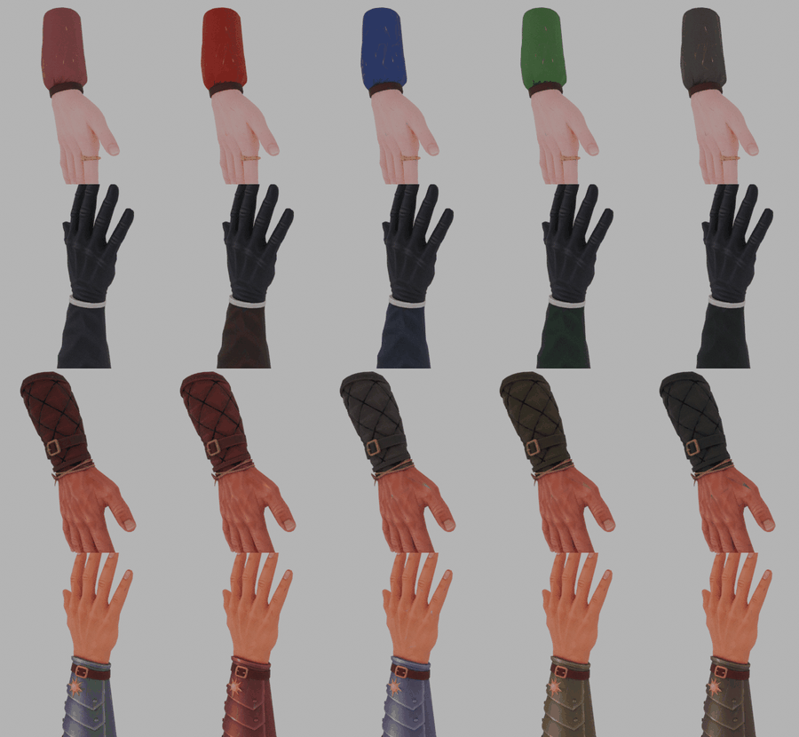
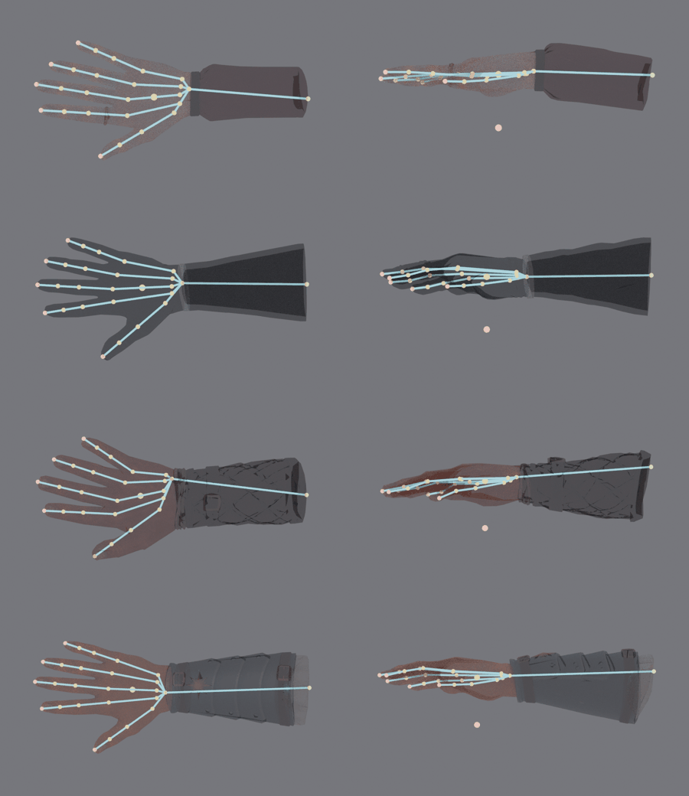
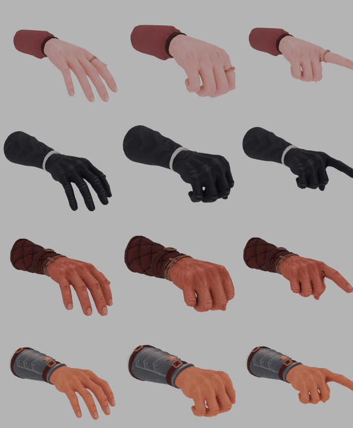

# First-person hands

Hand-and-forearm art for the first-person view, one per playable class: `channeler`,
`darklord`, `hound` and `zealot`. These are new art (the original game shipped no
first-person hands), made to sit in the original's world: modest triangle counts,
512x512 hand-painted-look textures, and palettes sampled from each class's original
character skin.

## What each class folder holds

| File | What it is |
|---|---|
| `<class>.glb` | The skinned right hand: one mesh, one material, UV0, smooth normals, the base texture embedded. No animations, cameras or lights. |
| `<class>_base.png` | Base colour (player colour 0). |
| `<class>_black.png`, `_blue.png`, `_red.png`, `_green.png` | Team colours 1-4: only clothing or armour changes; skin and accessories stay. |
| `<class>_mask.png` | Where the team colour applies, for a runtime tint if one is ever preferred. |
| `source/<class>-meshy-512.glb` | The source mesh: the Meshy model with its texture baked to 512. |
| `source/colours.json` | Team-colour targets, sampled from the original game's per-team skins for the class. |
| `provenance.json` | Prompts, Meshy task and parameters, tool versions. |
| `build.json` | Tool versions and script hashes of the build, and the output hashes. |
| `ue-verification.json` | Every bone as Unreal 5.8's glTF import reads it, checked against the skeleton contract. |

Texture choice follows `PlayerReplicationInfo.Color`: 0 base, 1 black, 2 blue, 3 red, 4 green.

## Skeleton

Right hand only; the left hand is mirrored at import. Stated in Unreal space after import
(X forward, Y right, Z up, centimetres):

- The origin is the wrist joint; wrist to middle fingertip is about 18.5 cm.
- Bind pose: palm down (-Z), fingers straight along +X and slightly spread, thumb toward -Y at about 45 degrees.
- 28 bones: `forearm_r` > `wrist_r` > `palm_r`, `grip_r`, the thumb chain
  (`thumb_metacarpal_r`, `_proximal_r`, `_distal_r`, `_tip_r`) and four finger chains
  (`<finger>_metacarpal_r`, `_proximal_r`, `_intermediate_r`, `_distal_r`, `_tip_r` for
  index, middle, ring and little). Joint placement follows the OpenXR hand-tracking joint set.
- Finger and thumb bones: local +X runs toward the child joint, local +Z to the nail side.
  Curling toward the palm is a rotation about local +Y that moves +X toward -Z.
- `wrist_r`, `palm_r`, `grip_r` and `forearm_r` use the asset axes. `grip_r` sits 4 cm
  below the palm, where a held object's origin goes.
- At most 4 bone influences per vertex. `palm_r`, `grip_r` and the tips carry no weight.

The poses above are made by flexing the bones about local +Y, the way the game drives the
finger curl.

## Rebuilding

`tools/build_hands.py <Art/hands> [class ...]` regenerates every deliverable from `source/`.
It needs Python 3 with numpy, Pillow and opencv-python, plus Blender (`BLENDER` names the
executable; 4.0 was used). `tools/hands.json` names, per class, the texture regions that
take the team colour and those that cover the forearm. The steps:

1. **Colour clusters:** k-means on the base texture (`tint_regions.py`), checked against the expected cluster colours.
2. **Geometric sleeve mask:** used where colour can't tell a sleeve from a glove (`dump_faces.py`, `geometry_sleeve.py`).
3. **Team-colour variants:** they keep each texel's shading (`tint_regions.py`).
4. **Densify:** split long edges where the fingers bend, so the knuckles deform cleanly (`densify.py`, `subdivide_hand.py`).
5. **Rig and write the .glb:** find the frame and landmarks from the geometry and silhouette, set the bone frames, generate the weights, and write the file with explicit joint transforms (`hand_rig.py`, `gltf_skin.py`).

The rest of `tools/` was used to make the sources:
- `meshy_i23d.py`: Meshy image-to-3D, with provenance.
- `rebake_512.py`: the 512 bake.
- `inspect_glb.py`: model checks.

Checks:
- **UE import:** `ue_import_dump.py` imports a .glb headless in Unreal and reads back the reference pose, and `verify_ue.py` compares it with the rig.
- **Previews:** `pose_test.py` and `render_variants.py` render posed and coloured previews; `render_bones.py` renders the bones.
